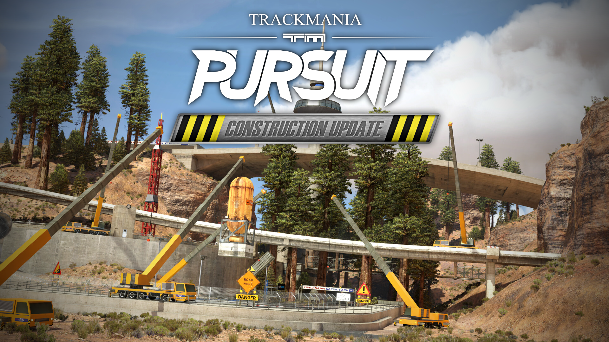
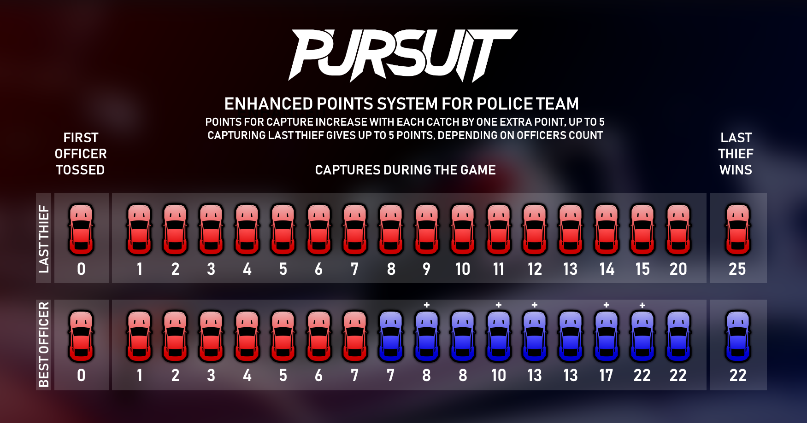
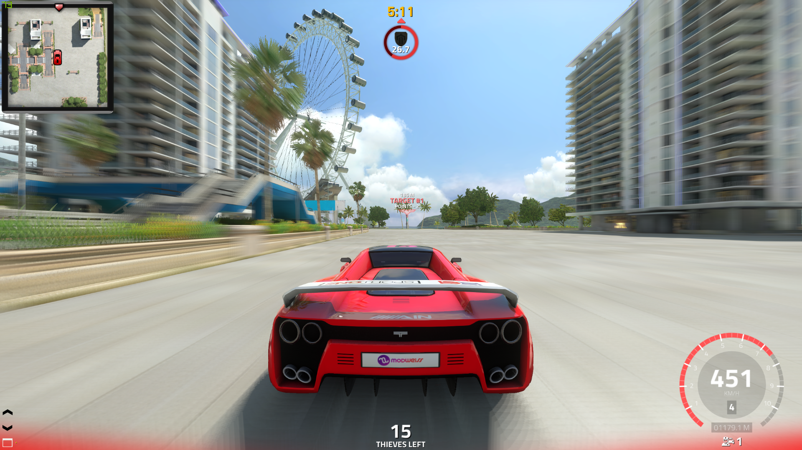
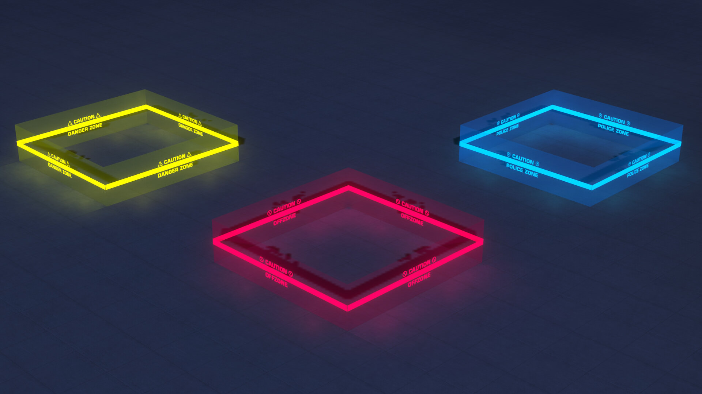
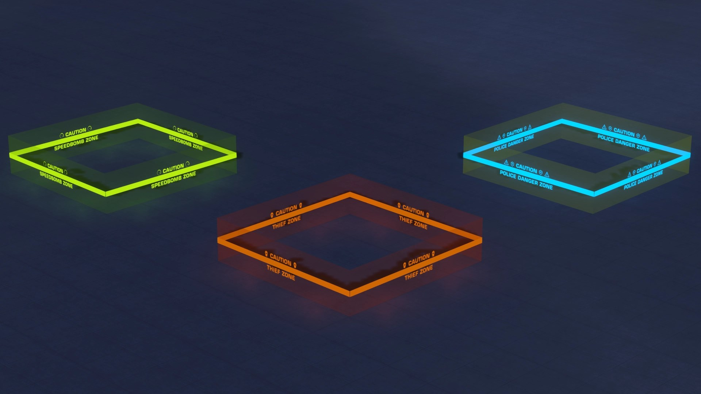
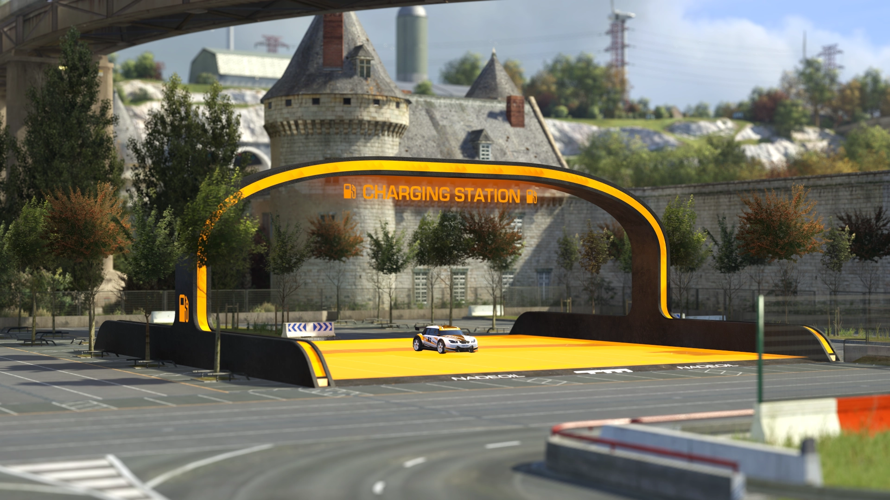
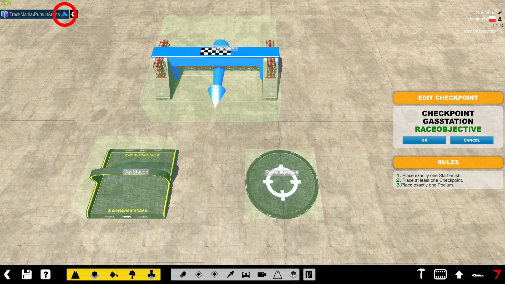

# Trackmania² Galaxy: Pursuit Mode
{: .no_toc }

Documentation of the **TrackMania² Galaxy** (formerly TrackMania² Pursuit) title pack — updates, zones, vehicles, and gameplay mechanics.
{: .fs-6 .fw-300 }

## Table of Contents
{: .no_toc .text-delta }

1. TOC
{:toc}

---

## Introduction

TrackMania² Pursuit is a title pack for ManiaPlanet that introduces a cops-and-thieves gameplay mode. Players are divided into two teams: **Police** (who chase and capture thieves) and **Thieves** (who survive and score points by evading capture). The mode supports multiple environments including Canyon, Stadium, Lagoon, and more.

*Third-person gameplay view showing the Pursuit HUD: minimap, timer, target indicator, and team status.*

---

## Title Update 1.1 (14 January 2018)

The first official title update after the packs premiered, focused on local play, the minimap and vehicle access.

### Split Screen Mode

Pursuit became playable in split screen — connect up to **4 gamepads** for up to 4 players on a single computer. Collisions are on.

{: .note }
> Keyboard is not available as an input device in split screen, and controllers are assigned randomly to the players.

### Minimap from ShootMania Galaxy

The ShootMania Galaxy minimap was rewritten to support TrackMania, so opponents and teammates appear on the radar. Players are shown as cars, with icons representing the vehicle they are currently driving. Appearance and behavior are tweakable via **Pause > Pursuit Settings > Minimap**.

{: .note }
> Thieves are hidden from the minimap if names are set to be not visible through walls.

### Police Skin for Canyon Car

If you drive the Canyon Car and become a policeman, a Police skin is applied to your car the next time you spawn. Skins for other cars were planned to follow.

### Lagoon Car Access

The Lagoon Car was locked to Lagoon maps only, after nearly everyone used it on other environments because it was overpowered. A new mechanic in the vehicle selection screen was implemented to unlock it on any environment for **30 minutes** by spending **15 Planets** — this option was unavailable at the time and still to be discussed with players.

### Other Cars on Stadium

Thanks to Openplanet, Canyon Car, Valley Car and Lagoon Car could be unlocked and used in the Stadium environment; once the game was patched they became selectable in the vehicle selection menu.

{: .note }
> Openplanet was not a public tool yet — players who had it were asked to contact Dommy on the Galaxy & Pursuit Discord for instructions.

---

## Title Update 1.2 — "Enhanced Points System" (29 January 2018)

This update introduced a completely overhauled, dynamic scoring system designed to balance the matches between the Police and the Thieves. It rewards late-game clutch play and ensures active participation until the final seconds of a round.

*Enhanced points system chart detailing the dynamic scaling of capture points for officers and survival points for the last remaining thief.*

### Capture Points Scaling (Police)

To reward more challenging captures in the late-game when fewer thieves are left on the track, the point value of each capture increases progressively:

- **Early-Game:** Standard captures are worth **1 point** (Captures 1 to 10).
- **Late-Game:** As the number of remaining thieves decreases, the value of subsequent captures scales up by +1 point per stage, up to a maximum of **5 points** per capture (e.g., Capture 11 is worth 2 points, Capture 12 is worth 3 points, etc.).
- **Last Thief Capture:** Safely securing the final surviving thief awards up to **5 bonus points** to the capturing officer, scaling dynamically based on the total number of active police officers currently on the server.

### Survival Points (Thieves)

Thieves are rewarded for their evasion skills and durability:

- **Elimination Points:** Every active thief receives **1 survival point** whenever another thief is caught by the police, provided they remain uncaptured themselves.
- **Last Thief Wins:** If the final remaining thief evades the police until the round timer expires, they receive a massive **+5 point bonus** on top of their accumulated survival points (e.g., reaching 25 total points instead of 20).
- **Capture streak:** each capture during a round grows your streak, increasing points per capture by 1, capped at 5.

### Killstreaks & Dominations

Brought over from ShootMania Galaxy:

- **Killstreaks** — a PENTAKILL note appears when you end the career of 5 thieves at the same time.
- **Dominations** — being captured by the same player 2 times in a row marks you as dominated, even across different maps, hours or days.

### Adjustable Minimap Zoom

Zoom level is set in **Pause > Pursuit Settings > Minimap**, with 4 options: **6x6**, **8x8** (default), **10x10**, **12x12**.

{: .note }
> A zoomed-out minimap gives no advantage to either team — opponents disappear from the map at the same distance regardless of zoom.

### Vehicles Shown in the Ranking

The scores table now shows each player's vehicle choice, making it easy to spot who bought Lagoon Car access on a Canyon map.

---

## Title Update 1.3 — "Construction Update" (25 June 2018)

### Vehicle Selection Screen

The vehicle selection screen now shows a picture of each car, a brief summary of pros and cons, and properly measured stats. Stats are displayed as a percentage score compared to the best car in every category.

*New vehicle selection screen showing the Valley Car with stats, pros & cons.*

### Map-Specific Gameplay Options

Mappers can now customize the game experience with several settings:

- **Choose available vehicles** — Select which vehicles can be used on your map. Only marked vehicles appear in the vehicle selection screen.
- **Force different cars for Police and Thieves** — For example, CanyonCar cops vs StadiumCar robbers.
- **Gameplay settings** — Choose between Pursuit or Hide & Seek mode, modify nametag behavior, toggle anti-camping mode, or disable free camera. Note: servers can force their own settings over map-specified ones.
- **Lock minimap rotation to North** — Useful for top-down camera angles.

### New OffZone Types

#### Danger Zone

A less lethal OffZone variant. Players inside the Danger Zone have **8 seconds** to leave before being eliminated. The zone is designed as a warning area rather than an instant-kill zone.

#### Police Zone

Marks routes available only for the Police team. Any thief who enters is instantly moved to the Police team.

{: .note }
> None of the OffZone types are automatically marked with in-game items. Mappers must place visual indicators manually using ornaments.

---

## Title Update 1.3.1 (2 July 2018)

### Zone Items by florenzius

Designed by Dommy and crafted by florenzius, these decorative items indicate the location of all three zone types:

- **OffZone** border indicators
- **Danger Zone** warning indicators
- **Police Zone** boundary indicators

*Neon zone indicators by florenzius: yellow (Danger Zone), red (OffZone), blue (Police Zone).*

{: .warning }
> These items are **only decorations** — they do not act as zones. You must place the zone manually using the Pursuit OffZone plugin, then use these decorations for visual feedback.

### Minor Changes

- Custom chat now shows message time; multiline chat issues are fixed.
- Alternative gameplay Stadium vehicles now have skins applied (Police CanyonCar displays correctly).
- Decoration size is now selectable in the Stadium pack.

---

## Title Update 1.4 — "4 Years of Pursuing" (19 February 2019)

Released on the 4th anniversary of the mode's first release, together with florenzius.

### Capture Assists 👮‍+👮‍

The game now detects who contributed to catching a thief besides the person who made the capture. You are considered an assistant if you:

- **Chase** a thief for long enough (chase sequence detected).
- **Provoke** a thief to start moving/escape (nearest policeman within range gets the assist).
- **Force a thief** to drop off ledges, cliffs, or drive downhill (nearest policeman gets the assist).

**Rewards:**
- Assisting in a capture gives you **1 point**.
- If you are marked as an assistant and the thief dies through any other means, it counts as **your** catch.
- Assistance status is kept for **15 seconds** after performing a qualifying action.

### TrackMania Forever Vehicles 🚗

All 6 "new" TrackMania Forever vehicles are now available without Planet paywalls:

- Upgraded **Island Car**
- Upgraded **Desert Car**
- Upgraded **Snow Car**
- Plus additional models from Purification and TM ONE crew

{: .note }
> TrackMania 2 vehicles were unavailable for the first week to let players experience the new cars in their full glory.

### Goal Hunt Pursuit 🎯

A new gameplay variant combining Pursuit with Goal Hunt:

- Thieves don't get survival points when someone else is captured.
- Instead, thieves play **Goal Hunt** to score points (2 points per goal reached).
- Each thief has an individual goal; once reached, the next is picked randomly.
- Once caught, the only way to score is by catching thieves as a policeman.
- Available with standard Survival Pursuit — just add Goal Hunt maps to a server.

### Speedbomb 💣

A new mechanic that "equips" your car with a bomb ignited by driving at **slow speed**:

- Camping triggers an explosion after **5 seconds** of inactivity.
- Forces players to stay fast or lose their thief/policeman status.
- Maps can enable/disable Speedbomb in their properties.

### 3 Brand New Zones 🚧

#### Thief Zone 🦹‍

- Accessible only by thieves. Police cannot enter (instant respawn).
- Thieves can stay inside for **2 seconds maximum** — creates short escape shortcuts.
- Time remaining does **not** reset when leaving; regenerates slowly to prevent camping.

#### Speedbomb Zone 💣

- Enables the speedbomb mechanic for any player inside this zone.
- Minimum speed requirements are **twice as high** as map-wide Speedbomb (200 km/h).
- Limits can be customized in map properties.

#### Police Danger Zone 👮‍⚠

- A **combo zone** created by placing both Danger Zone and Police Zone in the same area.
- Combines both effects: police-only access with the 8-second escape timer for thieves.

*New zone indicators: green (Speedbomb Zone), orange (Thief Zone), blue/cyan (Police Danger Zone).*

### Fuel & Charging Stations ⛽

Maps can feature **Charging Stations** that enable a fuel mechanic:

- Cars have a gas tank that slowly depletes while driving.
- **Full tank**: 3 minutes of driving OR 12 minutes of standing still.
- Refilling is almost immediate upon entering a station.
- When fuel is enabled, **policemen must wait 15 seconds** for respawn (same as thieves) to maintain balance.

*The Charging Station object placed on a map — players refuel here to keep driving.*

### Race Objectives 🎯

Points placed on tall or climbing-heavy maps:

- Each Race Objective starts with up to **10 points** (depending on player count).
- First player to reach it gets the most points; each subsequent player gets one less.
- Once depleted, the objective no longer awards points.
- Points are awarded regardless of team.

### UI Optimization

- Client UI is now fully separated from server updates.
- UI bugs can be fixed without a server update.
- Translations can be updated independently.

### Quality of Life Changes

| Change | Details |
|--------|---------|
| **Thieves buffed** | Up to 4 survival points (instead of 1): doubled once half the thieves are gone, 3 points when a quarter remains, 4 points for the last 1/8 |
| **Lagoon Car bonus** | +1 point for capturing a Lagoon Car thief in a different car (also applies to assists) |
| **Lagoon Car time** | 2 hours (instead of 30 min); timer ticks only while spawned with the car, and only if the map doesn't force Lagoon Car for everyone |
| **No spawn multi-kills** | AFK players at spawn become policemen when the round starts |
| **Spawn delay** | First spawn has a 1.5s delay to prevent game-hang desync |

### Mapper Notice: Charging Stations & Race Objectives

To enable these items on your map:

1. Edit the anchor data of the item.
2. Set the tag to `GasStation` or `RaceObjective` accordingly.

*Map editor showing anchor data configuration with GasStation and RaceObjective tags.*

{: .warning }
> **Both items must be placed:**
> - Level horizontally (no rotation on any axis)
> - Aligned to cardinal directions
> - Can be placed off-grid at arbitrary X/Y/Z coordinates

### Mapper Notice: Customized Gas Stations & Race Objectives

On 15 March 2019, Dommy clarified that **customized** Gas Stations and Race Objectives made by mashing the items with blocks via Mesh Modeller are **not allowed and unsupported**:

- The shape of their triggers is hardcoded in the game mode.
- Modified variants are very likely to break player detection — distorted items may detect players incorrectly or not detect them at all.
- Support is not planned, both because of the trigger-shape complications and to keep easily recognizable landmarks with specific functions consistent across maps.

---

## Title Update 1.4.1 (25 February 2019)

A small week-one patch for both the Multienvironment and Stadium titles:

- TrackMania 2 cars were unlocked again.
- Added a setting to override the list of cars forced by the map.
- Added a setting to enable **vehicle rotation**: randomly selected cars become the only ones available, in the number specified by the setting.
- Made "chase" assist detection less strict, allowing assists to happen more often.
- Fixed Danger Zone and Thief Zone icons remaining on screen after unspawning.
- Danger Zone and Thief Zone timers now start only after the player has started.
- Speedbomb is no longer active in the "Waiting for players" sequence if the previous map enabled it globally.
- The map type now saves `-0:00.001` as the author time instead of `0:00.001`.
- Capture combo points are now present in Goal Hunt Pursuit to balance out the teams.
- Removed last-thief and surviving-to-the-end point awards in Goal Hunt Pursuit. The only way to earn points as a thief in this mode is through capturing checkpoints.

---

## Several Small Updates (12 July 2019)

Over the weeks following 1.4.1, several changes were deployed gradually to both Pursuit packs.

### Improved Next Map Selection Screen

The redesign aims to expose players to a wider variety of maps and make every vote individual:

- Replaying the just finished map is no longer available (at least for now).
- Vote counts for each map are shown only after voting is complete, so players are not influenced by others' choices.
- The game remembers which maps you recently played and shares this with the server, which shows the **6 maps played least often** by currently connected players.

{: .note }
> In case of a tie, the **first map to receive a vote wins**. If you change your mind after voting for a map and that first pick ties with anything else, your initial pick still wins.

**Voting algorithm in detail:** playing at least one full round on a map adds it to the beginning of your recently played list (or moves it back to the start if already there). When voting begins, the server collects a list of 15 maps from all players. Based on a map's position in each list, it gets between 1 and 15 points — more recently played maps get more points. Maps are then ordered by points ascending, and the first 6 (least points) appear as voting options.

### Redesigned Vehicle Selection Menu

- All 10 car buttons fit on the whole screen, spaced out more evenly.
- Skins are featured in the buttons as well.
- UI elements behind the menu are hidden to prevent blending.
- The new menu supports an experimental live car preview at the start of a map.

### More Elimination Icons

New icons replace the "drowning car" symbol shown on environmental captures, reducing text bloat on screen.

### Enviromixing Soundtracks

The music player received its first playlist: a full mix of all 27 tracks heard in Canyon, Stadium, Valley and Lagoon. Available in the Multienvironment pack only. Shuffle is on by default, and repeat one was added.

{: .note }
> A future music player rewrite was planned to let all players on the server listen to the same track at the same time, with admins controlling the currently played track.

### Progressive Respawn Time

For years, thieves had to wait 15 seconds to respawn. This became progressive:

- At the start of a round, retrying takes only **5 seconds**.
- As the round progresses and more thieves are caught, the time gradually extends up to **15 seconds** for the last thief remaining.
- The game informs everyone if a captured player was about to respawn.
- Respawn always takes 5 seconds in the Goal Hunt variation.

### Balanced Cop Points

Capturing a thief in the late game could be worth only 1 point while survivors got up to 3, discouraging captures for point-focused players. Cop points are now based on thieves' points, giving up to 3 for a regular capture and up to **8 points in total**:

- 1–3 base points, up to 5 for the last thief.
- 0–4 capture streak points (if not the last thief).
- +1 for catching a Lagoon Car with any other car.

---

## Title Update 1.5 — "Pursuit SWAP" (22 July 2019)

### Pursuit SWAP

A mutation of regular Survival Pursuit: half the players start as cops and half as thieves. Catch thieves to score 5 points or survive to gain 1 point. The twist is that **all players swap roles every 30 seconds** — cops become thieves and vice versa — with 10 swaps during the match. The player with the highest score wins.

- Played on **HuntersArena** maps, within the same game mode script as other Pursuit variants.
- SWAP was played on channels for one week, after which its maps were merged into the regular Pursuit playlist.

### Overtime

When the timer hits the limit but a thief is still being chased, the game continues until they lose their tail or get captured. Overtime applies only to Survival and Goal Hunt variants.

### Other Changes

- **Stadium red turbos** can now be used to construct more extreme maps.
- The exploit allowing thieves to switch to spectator mode without consequences (denying remaining survivors their survival points) was fixed. Any policeman who could have got an assist on such a thief now receives points for capturing them.

---

## Title Update 1.6 — "Galaxy" (17 October 2019)

The title packs were rebranded from **TrackMania² Pursuit** to **TrackMania² Galaxy** (the Pursuit mode kept its name), and became free — no Planets required. The update also brought a new ranking page, exclusive player badges, interface tweaks and a large set of technical changes.

Dommy's goal behind the rename is a unified ecosystem housing both his TrackMania and ShootMania titles with a shared profile, stats, achievements and unlockables. ShootMania Galaxy is planned to be revived on the new Pursuit codebase, which is compatible with both TM and SM.

### Additions

- New, redesigned ranking screen with detailed player info, gamepad navigation, match info in the header, per-player stats in the footer, and separate round/match points.
- Exclusive badges next to player names for important contributors (models, translations, long-time mappers, competition winners); most Nadeo members have one.
- Points are split into round points and match points — green PTS are added to the Total at the end of the round, like in ShootMania or Rounds/Cup modes.
- **Proximity assists** — least-priority assists for cops within 8 metres of a thief (a quarter of a Stadium block).
- Gamepad support for the vehicle selection and map selection screens.
- Scoreboard now counts assists scored by each player.
- **Active and Passive thieves system** — thieves actively driving gain more survival points, while campers' points are capped.
- Test mode in the map editor (avoid for now — impossible to return to the editor).
- Speedometer now fakes the first 1k RPM to reflect idle engine sounds of TMU vehicles, plus other cosmetic speedometer changes.
- Platform soundtrack, an easter egg related to drifting, and an easter egg played when capturing or being captured by a specific player.
- **TrackMania² Galaxy Canary** — development branch of the Stadium title for testing.
- Discord advertisement under the scoreboard.

### New Ranking Page in Detail

Fully rewritten by Dommy, no longer relying on the outdated ManiaPlanet 3 scripts — it no longer randomly crashes upon joining.

- **Gamepad navigation** — D-Pad or Right Stick up/down moves a page up or down; D-Pad left/right switches between tabs.
- **Header** — information about the ongoing match plus the logo of the played game mode, for easier recognition in channels.
- **Footer** — your stats (or the spectated player's): survival score, captures, assists, total points and current placement.
- **Vehicle icons** instead of cryptic 1-letter abbreviations — hover for the full car name, click to switch to it (if you can respawn).
- **Best players page** remade — previously only under Left Alt, now available under Tab and through the gamepad.
- More room for player names, with badges shown next to nicknames.

### Exclusive Player Badges

Prestigious rewards for players important to the development and upkeep of the Galaxy packs, shown next to the player name in the scoreboard and nametags (more locations planned).

{: .note }
> Badges cannot be bought — they are earned by contributing models or translations, being a long-time mapper, or winning official competitions. Most Nadeo members have one.

### Minor Design Tweaks & Canary

- Some interface elements were refreshed, with animations applied for a more polished feel.
- **Canary** is the pack where all pre-release tests happen; it is only for people interested in testing new features, with information posted on the official Discord.

### Changes

- Both titles officially renamed to TrackMania² Galaxy and made free of Planets payment.
- Hunters mode updated and playable again.
- Most files reorganized and converted to WebP, JSON and OGG.
- Tweaked UI placement/effects internals, resulting in fewer frame drops.
- Assists optimized — checked twice a second instead of every frame (100 frames → 2 frames).
- Capture detection optimized with smarter distance calculation.
- Speedometer RPM gauge slightly interpolated to reduce jitter in TMU cars.
- More split-screen compatibility.
- Fixed: Thief Zone timer appearing for cops; on-screen messages with links staying after the message disappears; faulty detection of random chase assists; incorrect visibility of player names during the preparation phase ("random" disappearances).

### Deletions

- Removed discontinued server manager ("Players list").
- Removed obsolete code.
- Removed obsolete buttons from the pause menu.

---

## Forum Discussion Highlights

### Zone Visibility (June–July 2018)

**Miss** asked how the Police Zone is indicated in-game. **Dommy** (title creator) responded:

> Unfortunately none of all OffZone types are automatically marked with any items whatsoever. The Police Zone remains a mystery until one accidentally drives into it. Danger Zone causes less trouble, since one gets some time to escape.

Dommy envisions the indication as something similar to NFS barrier arrows, but with police car icons and a "Police Zone" text.

### Auto-Placement of Zone Items (July 2018)

**Miss** suggested placing visual feedback items automatically for consistency. **Dommy** explained:

> Placing the items automatically would be possible only if:
> 1. TrackMania supports dynamic items (like ShootMania), OR
> 2. Map types / editor plugins can place items.

Manual placement has an advantage — the mapper marks only the entrance, while a script would place items inside walls or overlap with them.

Dommy added that OffZone is an old mechanic players already expect in obvious places (outside the map, deep pits, water), so its border item should be used in less obvious scenarios — the ledge of a floating platform or the top of a tall building. At the time (July 2018) only 4 maps took advantage of Danger Zone and Police Zone.

---

## Galaxy Rebase — TMAll Update (27 November 2024)

TrackMania² Galaxy has been **rebased on the latest version of TMAll**, bringing all the newest TMAll features directly into Galaxy. This is a major milestone unifying the codebase.

{: .note }
> Announced by Dommy on the Galaxy Discord on **27 November 2024, 20:02**: "The most unexpected news of the year, for Galaxy: TrackMania² Galaxy (Multienvironment & Stadium) have been updated! Galaxy has been rebased on the latest version of TMAll, meaning that all the newest TMAll features are available directly inside Galaxy! This includes MP Store and trailer skins for TM2 cars in Stadium for thieves!"

### 🎉 New Features

- **MP Store integration** — access the ManiaPlanet Store directly from Galaxy
- **Trailer skins for TM2 cars in Stadium** — custom skins now available for thieves in Stadium environment
- **Persistent Storage Crash Fix** — the notorious "29.9 bug" is now resolved
- **Goal Hunt Maps** — all Goal Hunt maps (including new ones) are now properly detected and automatically switch the mode to Goal Hunt Pursuit
- **TrafficCar playable in Pursuit** — available if the currently played map explicitly enables it (to keep ValleyCar relevant)
- **LagoonCar in Map Editor** — now fully accessible inside the editor
- **Map Voting Screen update** — now correctly suggests 6 least-played maps of the currently playing players, instead of being effectively random
- **Galaxy Stadium fresh look** — new Stadium-themed image replacing the old colour-shifted version
- **Car model fixes** — Bay Car, Coast Car, and Rally Car no longer turn white on dirt surfaces

### ⚠️ Known Limitations

- **TMU car models** remain unchanged for now
- **Galaxy Stadium** currently does not allow creating maps with different vehicles (may or may not be fixed in the future)

---

## Environments

| Environment | Game |
|---|---|
| **Canyon** | TrackMania² Canyon |
| **Stadium** | TrackMania² Stadium |
| **Valley** | TrackMania² Valley |
| **Lagoon** | TrackMania² Lagoon |

## Vehicles

| Vehicle | Game |
|---|---|
| **CanyonCar** | TrackMania² Canyon |
| **StadiumCar** | TrackMania² Stadium |
| **ValleyCar** | TrackMania² Valley |
| **LagoonCar** | TrackMania² Lagoon |
| **IslandCar** (redesigned by Purification) | TrackMania² Island |
| **BayCar** | TrackMania United Forever |
| **CoastCar** | TrackMania United Forever |
| **SpeedCar** (known as *DesertCar*) | TrackMania² Speed |
| **AlpineCar** (known as *SnowCar*) | TrackMania² Alpine |
| **RallyCar** | TrackMania United Forever |
| **TrafficCar** | TrackMania² All |

---

## Related Links

- [ManiaExchange](https://tm.mania.exchange)
- [Pursuit Discord](https://discord.me/pursuit)
- [Openplanet](https://openplanet.dev)

---

{: .note }
> This page is based on archived project discussions. For the latest information, check the official Openplanet resources or the Pursuit Discord.
