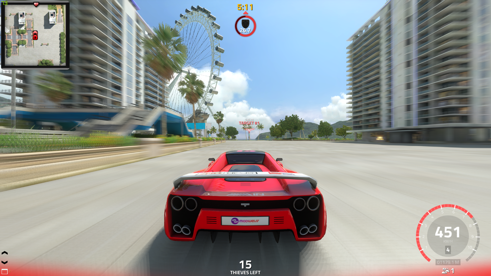
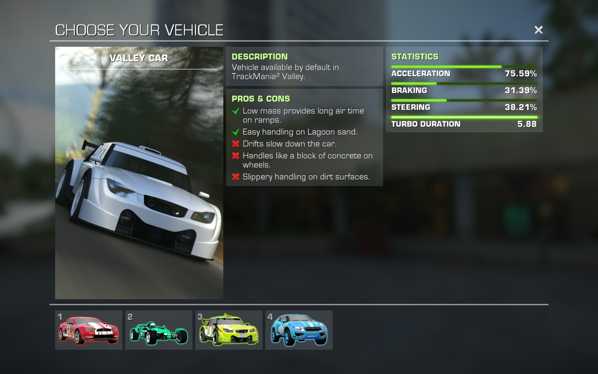
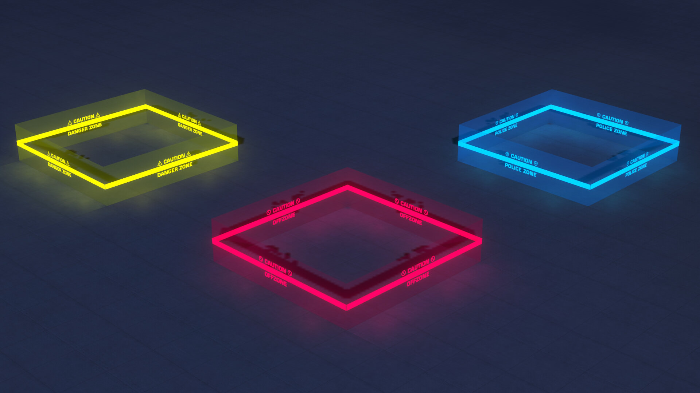
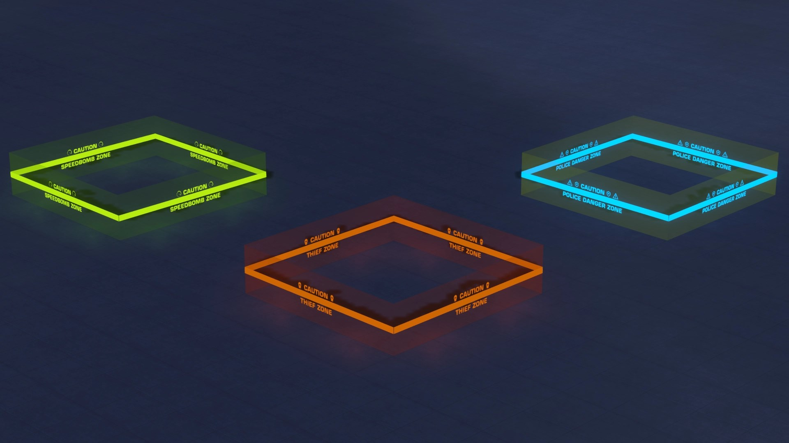
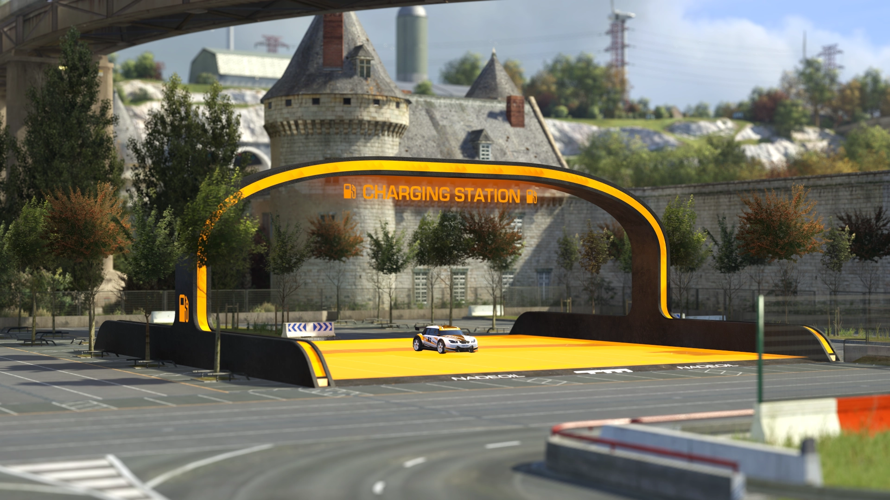
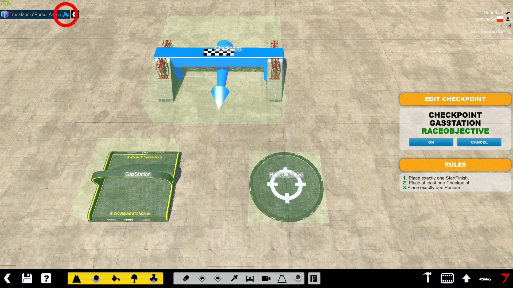
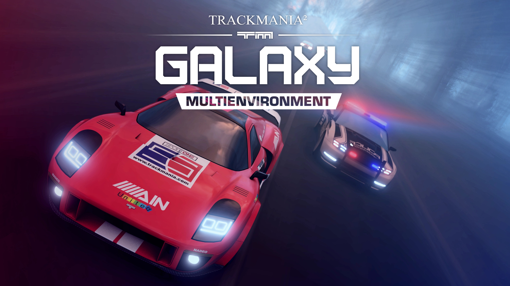

Showcase of Trackmania Galaxy screenshots and map previews.

Looking for a specific map? See the [Map Gallery](../../) for per-map galleries and record histories — anyone can submit a screenshot or a time.

---

## TrackMania² Pursuit


*Third-person gameplay view showing the Pursuit HUD: minimap, timer, target indicator, and team status.*


*New vehicle selection screen showing the Valley Car with stats, pros & cons.*


*Neon zone indicators by florenzius: yellow (Danger Zone), red (OffZone), blue (Police Zone).*


*New zone indicators: green (Speedbomb Zone), orange (Thief Zone), blue/cyan (Police Danger Zone).*


*The Charging Station object placed on a map — players refuel here to keep driving.*


*Map editor showing anchor data configuration with GasStation and RaceObjective tags.*

---

## Trackmania Galaxy



---

## How to Contribute Images

We welcome new screenshots and gallery contributions! Here's how to add your own:

1. **Take a screenshot** — Use the in-game screenshot function or a tool like ShareX.
2. **Upload to the repository** — Go to `src/assets/images/` on [GitHub](https://github.com/tomekdot/trackmania-galaxy) and click "Add file" → "Upload files".
3. **Use descriptive names** — e.g., `pursuit-hud.jpg`, `valley-vehicle-select.png`.
4. **Reference in Markdown** — Add your image to this page using a relative path:
   ```md
   
   ```
5. **Submit a Pull Request** — Your images will be live after review.

:::note
By uploading images, you agree they will be licensed under [CC BY-SA 4.0](https://creativecommons.org/licenses/by-sa/4.0/), matching the wiki's content license.
:::
